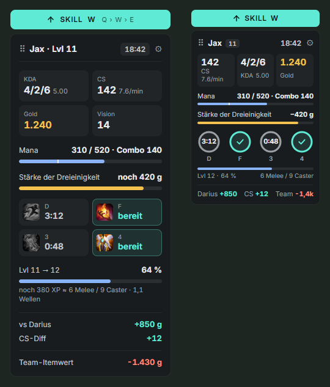
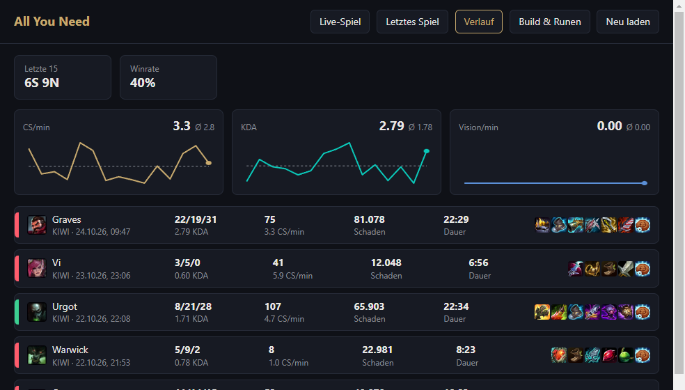
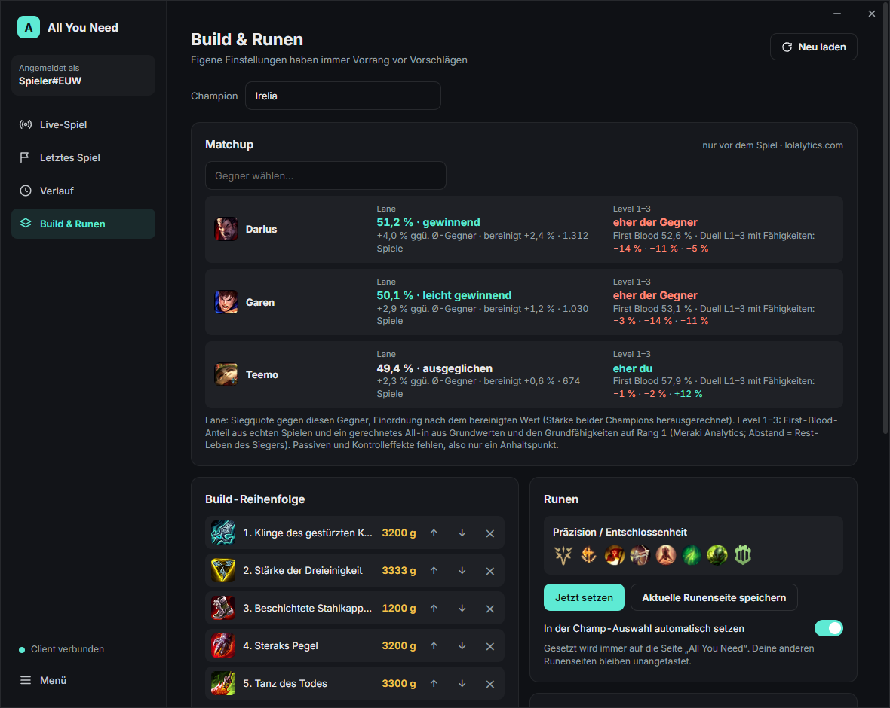

# All You Need – A lightweight overlay

**Version 1.3** · [Changelog](CHANGELOG.md) · [Download](https://github.com/JamyH/all-you-need/releases/latest) · [💡 Share an idea](https://github.com/JamyH/all-you-need/issues/new?template=idea.yml)

A small, clean overlay for League of Legends on Windows. It shows what matters in a fight – exact CS,
your summoner cooldowns, XP to the next level, mana for your combo, the gold you still need – without
covering your screen. It only uses information you can already see as a player and never touches the
game process.

> The interface is currently in **German**. An English UI is planned.

<p>
  
  
</p>

## Download

1. Grab the latest **`All-You-Need-Setup-x.y.z.exe`** (installer) or **`All-You-Need-x.y.z-portable.exe`**
   (no install) from the [Releases page](https://github.com/JamyH/all-you-need/releases/latest).
2. Start it. Windows SmartScreen may warn because the app is not code-signed: click *More info → Run anyway*.
   This is a reputation warning for new, unsigned files, not a virus detection – Microsoft Defender finds
   nothing in it. You can compare the file's SHA-256 checksum with the one listed in the release notes
   (PowerShell: `Get-FileHash .\All-You-Need-Setup-x.y.z.exe`), and the full source is in this repository.
3. Set League to **Borderless** or **Windowed** (an overlay cannot sit on top of exclusive fullscreen).

That's it. The League folder, your resolution and your HUD scale are detected automatically.

## Your ideas are welcome

All You Need grows from what players actually miss in their games – so **please bring in your own ideas**,
even very personal ones. Something that would help you in a specific situation, a small annoyance, a
whole new feature: all of it is explicitly wanted.

👉 **[Share an idea](https://github.com/JamyH/all-you-need/issues/new?template=idea.yml)** (short form, German or English)

The only limit is Riot's rules: the app uses official APIs and what is already visible on your screen,
so things like enemy cooldown timers or augment win rates are off the table. Post those ideas anyway –
often there is an allowed variant. Found something that is read wrong? Use the
[bug form](https://github.com/JamyH/all-you-need/issues/new?template=bug.yml) instead.

## Features

**In-game panel**
- KDA, exact CS (read from your HUD), CS/min, gold, vision
- Summoner spell cooldowns (D/F) with countdown, re-synced with the HUD every 10 s
- XP to the next level, including "X melee / Y caster minions"
- Mana bar with your combo cost (Q+W+E+R at current ranks) and a **NO MANA** warning
- Savings goal: next item from your build, gold still missing, **RECALL** once you can afford it
- Skill hint: which ability to level next (lolalytics skill order) while a point is unspent
- Item cooldowns (Zhonya's, Stopwatch, Guardian Angel …) read from your item slots
- Item value difference to your lane opponent and the enemy team

**Tab scoreboard**
- Item value difference per row (above the ward slot) plus team difference
- Finds the scoreboard on its own, even if you moved it

**Stats window**
- Live game: all 10 players with rank, win rate, level, KDA, CS, vision, items, item value
- Last game and match history with trend charts (CS/min, KDA, vision)
- Build order and rune page per champion; runes are applied automatically in champ select to a
  dedicated page called "All You Need" (your other pages are never touched)
- Build and rune suggestions from [lolalytics.com](https://lolalytics.com) for your champion and role,
  loaded once when you lock in; your own builds and runes always take priority (can be switched off)
- Several rune pages to choose from (lolalytics plus Riot's recommended pages for your role): apply one
  with a click or keep it as your own; the stats window opens on lock-in without stealing focus



## Hotkeys

| Key | Action |
|---|---|
| Ctrl+Shift+O | Toggle overlay |
| Ctrl+Shift+E | Move panel (or drag the ⠿ handle) |
| Ctrl+Shift+S | Stats window |
| Tab (in game) | Scoreboard badges – the key is only read, the game still receives it |

## Resolution and HUD scale

Screen regions are computed from your resolution and League's HUD scale (read from `Config/game.cfg`).
Tested at 3440×1440 with HUD scale 0 and 100, and at a simulated 2580×1080. If something is read
wrong, open the stats window → *Live-Spiel* → **Erkennung prüfen** during a game: it shows exactly
which screen areas are read and what was recognized. Please attach that screenshot plus your
resolution and HUD scale to an issue.

## Where the data comes from

| Data | Source |
|---|---|
| In-game values | Live Client Data API (`https://127.0.0.1:2999`, only during a game) |
| Ranks, history, runes, champ select | League client API (LCU), credentials from the client's `lockfile` |
| Item, champion and rune data, icons | Data Dragon (Riot's public CDN), cached locally |
| Exact CS, cooldowns, XP, scoreboard | Small screen regions, analysed locally (own digit recognition, Tesseract as fallback) |
| Build and rune suggestions | [lolalytics.com](https://lolalytics.com) build page (Emerald+), one request per champion and role, cached for a day; fallback for runes: Riot's own recommended page from the client |
| ARAM Mayhem augment tiers | Data: [arammayhem.com](https://arammayhem.com/data/) ([CC BY 4.0](https://creativecommons.org/licenses/by/4.0/)): pick rates and combo tags, no win rates (Riot does not allow augment win rates); English names from [CommunityDragon](https://communitydragon.org); both cached for a day |
| Stat Anvil shards | Rated locally against your build (item tags from Data Dragon) |

No Riot API key is needed. Apart from Data Dragon, the lolalytics build page, the arammayhem.com and
CommunityDragon data (only in ARAM Mayhem) and a one-time download of the OCR language data, nothing
leaves your PC. Only the champion and role are part of these requests.

## Building from source

```
npm install
npm start          # run in development
npm run dist       # build installer + portable exe into dist/
```

Requires Node.js 20+. Settings live in `%APPDATA%\All You Need\config.json` (created from
`config.example.json` on first start), shared by `npm start` and the installed app.

To use the app straight from source without building, create a shortcut to
`node_modules\electron\dist\electron.exe` with the project folder as argument. Changes to `renderer/`
reload instantly; for everything else restart the app.

| File | What it does |
|---|---|
| `src/live.js` | Game data → panel values |
| `src/layout.js` | Screen regions for any resolution and HUD scale |
| `src/ocr.js`, `renderer/capture.js` | Screen reading and scoreboard search |
| `src/digits.js`, `src/digits.json` | Digit recognition; templates learned with `tools/digit-samples.js` |
| `src/lcu.js` | League client access |
| `renderer/overlay.*`, `renderer/stats.*` | Panel and stats window |
| `tools/` | Calibration and render helpers |

## Third-party

- [Electron](https://www.electronjs.org) – MIT
- [tesseract.js](https://github.com/naptha/tesseract.js) – Apache-2.0
- [uiohook-napi](https://github.com/SnosMe/uiohook-napi) – MIT
- Fonts Cinzel and Source Sans 3 via Google Fonts – SIL Open Font License

## License

MIT, see [LICENSE](LICENSE). Use at your own risk: this project is not reviewed or approved by Riot
Games, and Riot may change the interfaces it relies on at any time.

## Legal

All You Need isn't endorsed by Riot Games and doesn't reflect the views or opinions of Riot Games
or anyone officially involved in producing or managing Riot Games properties. Riot Games, and all
associated properties are trademarks or registered trademarks of Riot Games, Inc.
